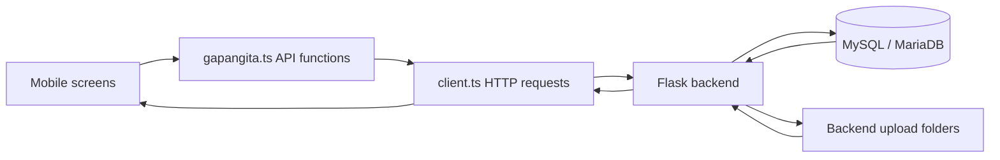

# GApangita Mobile Documentation

This document describes the current mobile application, its Flask backend, file storage, database, and how they interact. It is based on the source code as of October 26, 2026. The separate `frontend/` application is outside this document's scope.

## 1. System overview

GApangita is a campus lost-and-found application. Visitors browse listings and submit ownership claims. Signed-in Admin and Staff accounts report items, review claims, and manage archived items.

The application has three main parts:

| Part | Location | Responsibility |
| --- | --- | --- |
| Mobile application | `mobile/` | Screens, navigation, input validation, confirmations, and HTTP requests. Built with Expo, React Native, TypeScript, and Expo Router. |
| Backend API | `backend/app.py` | Authentication, authorization, request validation, upload handling, and database transactions. Built with Flask. |
| Database | MySQL/MariaDB server; setup defined in `database_setup_test.sql` | Item and claim records, accounts, lookup data, restore history, logging, and lifecycle rules. |



The mobile app does not connect directly to MySQL. All database access goes through Flask. Images and PDFs are sent to Flask, stored as files, and referenced by relative paths in database rows.

## 2. Project structure

```text
GApangita/
  documentation.md                 This guide
  database_setup_test.sql           Full database creation/reset script
  Implementation.md                Earlier implementation notes
  mobileplan.md                    Mobile planning and implementation notes
  plan.md                          Earlier project rules/plans
  backend/
    app.py                         Flask API and upload handling
    requirements.txt               Python dependencies
    pip_install.bat                Dependency installation helper
    start.bat                      Starts Flask from the backend directory
    uploads/
      items/                       Uploaded report photos
      evidence/                    Uploaded claim images/PDFs
      claimant/                    Legacy directory; current claims use evidence/
  mobile/
    .env                           Local API address configuration
    app.json                       Expo configuration, plugins, icons, permissions
    package.json                   Dependencies and npm commands
    tsconfig.json                   TypeScript configuration
    eslint.config.js               Lint configuration
    expo-env.d.ts                  Expo TypeScript declarations
    assets/
      images/                      Bundled logo, icons, splash image
      fonts/                       Bundled font assets
    src/
      app/                         Expo Router screens and layouts
      components/                  Shared UI components
      features/                    Authentication, claim validation, archive UI
      services/api/                API request and endpoint functions
      theme/                       Shared colors
      types/                       TypeScript API/data contracts
    scripts/                       Development checks; not required at runtime
  audit/                           Earlier audit reports and verification results
  uploads/                         May contain files from root-directory launches
```

The database's physical data files are managed by the installed MySQL/MariaDB service. They are not stored in `database_setup_test.sql` or the mobile application. Their exact directory depends on the database installation.

The old backend audit, test, verification, and migration scripts were removed. Some historical documents still mention them; those commands are no longer available in the current backend folder.

## 3. Screens and navigation

Expo Router uses files in `mobile/src/app/` to define routes. A filename such as `[itemCode].tsx` represents a route parameter. The `(tabs)` directory groups tab screens without adding a literal `(tabs)` segment to the public URL.

| File under `mobile/src/app/` | Purpose |
| --- | --- |
| `_layout.tsx` | Root navigation stack, safe-area provider, shared authentication provider, and status bar. |
| `(tabs)/_layout.tsx` | Tab navigation; normal startup opens the Find/listing tab. |
| `(tabs)/index.tsx` | Browse/search open items, apply filters, paginate, and retry failed reads. |
| `(tabs)/report.tsx` | Signed-in lost/found item reporting, photo selection, and date/time selection. |
| `(tabs)/account.tsx` | Account/session information, sign-in/sign-out, and staff workflow links. |
| `items/[itemCode].tsx` | Public item details and claim availability. |
| `claims/[itemCode].tsx` | Public ownership claim form with optional evidence. |
| `login.tsx` | Staff/Admin sign-in. |
| `staff/claims.tsx` | Staff claim queue, including historical decisions. |
| `staff/claims/[itemCode].tsx` | Claim details, evidence access, notes, and review decisions. A `claimId` query parameter identifies the exact historical claim. |
| `staff/archive.tsx` | Archived-item list using the shared archive component. |
| `staff/unarchive-history.tsx` | Restore-history list. |
| `staff/restore/[itemCode].tsx` | Restore an eligible expired item with a recorded reason. |

Find, item details, and the claim queue refresh when revisited. There is no custom startup loading screen; that change was canceled. Individual screens still display loading indicators while requesting data.

### Access rules

| Action | Visitor / signed out | Signed-in Admin or Staff |
| --- | --- | --- |
| Browse open listings | Allowed | Allowed |
| Submit a public claim | Allowed after a successful guest-session check | Blocked; sign out first |
| Report an item | Requires sign-in | Allowed |
| Review claims/evidence | Blocked | Allowed |
| View archives and restore history | Blocked | Allowed |
| Restore an eligible expired item | Blocked | Allowed |

The mobile UI enforces these gates and the backend validates access again. Report submission currently checks for a logged-in session and valid CSRF token; claim-review endpoints explicitly require an Admin/Staff role.

## 4. Main user flows

### Startup and authentication

1. `_layout.tsx` mounts `AuthProvider` from `features/auth/AuthContext.tsx`.
2. The provider calls `GET /api/auth-status` through `client.ts`.
3. Screens wait for confirmed authentication state before allowing protected actions or public claiming.
4. On successful login, Flask verifies the stored password with bcrypt and establishes a signed cookie session. The response includes the user and a CSRF token.
5. The mobile app stores the CSRF token in Expo SecureStore under `gapangita.csrf`. Requests include session cookies using `credentials: 'include'`.
6. Mutating requests attach the saved token as `X-CSRF-Token`. Backend routes validate it where required.
7. Successful logout clears the server session and the saved token. Recoverable failures retain known account state and expose retry controls.

User information and authentication loading/error state live in React memory. The CSRF token is separate from the session cookie: storing the token alone does not establish a logged-in session. Cookie persistence across restarts depends on the native networking environment and must be verified on the target phone.

### Finding an item

The Find screen loads category/branch choices and branch-specific locations. `searchItems()` builds the query string for `/api/search`. Flask selects an open-item view, applies filters/search ranking and pagination, and serializes results through `public_item_row()`.

Public responses include the item reference, type, availability, category, public color, campus/branch, dates, and `can_claim`. Private descriptions, claimant contact details, and stored file paths are not included in this public listing response.

The backend uses Levenshtein-distance matching for relevant search terms. The mobile screen debounces requests and cancels obsolete searches so older responses do not replace current results.

### Reporting a lost or found item

1. The signed-in user enters the item name, description, category, campus, location, public color, and date/time.
2. The mobile form requires a photo for found items; a lost-item photo is optional.
3. Validation runs before the styled confirmation dialog appears. Cancel leaves the form intact.
4. `submitReport()` builds multipart `FormData`. The file field is named `item_image`.
5. Flask saves the photo, if accepted, and calls `sp_submit_report` with nine parameters.
6. Database triggers generate the item code and set its 21-day listing deadline. The backend commits and responds with HTTP 201.
7. The app displays success and clears the relevant form fields.

The database stores the full item details. Public listing responses expose only the selected public fields described above.

### Submitting a claim

1. A signed-out visitor opens an available item and selects the claim action.
2. The claim form collects identity/contact information, affiliation, an ownership description, and identifying features. Last-seen location/time, contents, additional details, and evidence are optional.
3. `features/claims/validation.ts` supplies field-specific validation. The screen scrolls to the first invalid field or the submission-error summary.
4. `OptionalDateTimeField.tsx` provides date/time pickers and a clear action. Values are formatted as local date/time strings, not timezone-tagged UTC timestamps.
5. After validation, an app-styled confirmation explains the submission and whether evidence is included.
6. Without evidence, `submitClaim()` sends JSON. With evidence, it sends multipart data with a file field named `evidence`.
7. Flask validates the request and optional file, then calls `sp_insert_into_claimed_items` with fourteen parameters.
8. The procedure locks the item, checks availability/expiry and active claims, and inserts a Pending claim. The backend commits and responds with HTTP 201.

An active duplicate returns HTTP 409. Missing items return 404. Unavailable/expired items return a conflict response. The backend limits public claim attempts to five per IP per minute using in-process memory; this limiter resets when the process restarts and is not shared across multiple server processes.

### Staff review and archiving

Staff open an exact claim record from the queue. They can inspect ownership details, request evidence, change the status, and save notes. Important saves require confirmation; success is displayed only after the API acknowledges the change.

| Current claim status | Allowed different status |
| --- | --- |
| Pending | Under Review, Approved, Rejected |
| Under Review | Pending, Approved, Rejected |
| Approved | Returned |
| Returned | Approved, to correct an incorrectly recorded return |
| Rejected | No reopening; staff notes can still be updated |

Saving notes without changing status is also allowed.

- Pending/Under Review reserves the item and displays it as Under Verification; it is not claimable by another person.
- Rejected releases the active slot. The item becomes Available again if its original 21-day deadline has not passed. Rejection does not restart that clock.
- Approved archives the item (`items.STATUS = 'resolved'`). Returned keeps it archived (`closed`). Correcting Returned to Approved keeps it archived.
- After 21 days, an item is excluded from public listings and included in staff archives even if a claim is still pending. An expired pending claim cannot be newly approved.
- Rejected claims, notes, ownership answers, and evidence remain stored when another claimant submits.

The unique generated `active_item_code` key allows multiple rejected historical claims for one item, but at most one Pending, Under Review, Approved, or Returned claim. Row locking and the unique key protect concurrent submissions.

### Restoring an expired item

Staff provide a reason of at least eight characters and confirm the restore. `sp_unarchive_item` records a restore-history row, increments `times_unclaimed`, and starts a fresh 21-day listing period. It retains existing claims and evidence. A retained pending claim still reserves the restored item. Approved/Returned items cannot be restored through this workflow.

## 5. Storage: what is stored where

| Data | Storage | Lifetime / representation |
| --- | --- | --- |
| Bundled logo/icons/fonts | `mobile/assets/` | Shipped with the app; not user uploads. `logo.png` is an existing bundled asset. |
| Form inputs, search results, loading/error state | React state in the mobile process | Not a persistent offline database. Unsaved forms are not guaranteed to survive navigation, process termination, or reload. |
| Selected photo/PDF before submission | Device-provided file URI; attachment metadata in React state | A selected URI is not yet a server upload. The app sends the file contents during submission. |
| CSRF token | Expo SecureStore, key `gapangita.csrf` | Cleared after confirmed logout or a confirmed guest session. Mobile browser builds use sessionStorage instead. |
| Login session | Flask signed cookie carried by the networking client | The backend configures a two-hour permanent-session lifetime and refreshes active sessions. This is not a custom JWT flow or database session table. |
| Item/claim/account/history records | MySQL/MariaDB database `gapangita_db_test` | Structured rows, relationships, status, timestamps, and relative file paths. |
| Report photos | Normally `backend/uploads/items/` | UUID-generated filenames such as `item_<uuid>.jpg`. |
| Claim evidence | Normally `backend/uploads/evidence/` | UUID-generated filenames such as `claim_<uuid>.pdf`. |
| Legacy claimant directory | `backend/uploads/claimant/` | Created by the backend; the current claim form saves into `evidence/`. |
| API address | `mobile/.env`, `EXPO_PUBLIC_API_URL` | Public build configuration, not a place for secrets. |

### Example: a claim attachment

```text
Phone selection:
  file:///.../proof.pdf

HTTP upload:
  POST /api/claims
  multipart field: evidence

Server file:
  backend/uploads/evidence/claim_<uuid>.pdf

Database value:
  claimed_items.evidence_file_path = "evidence/claim_<uuid>.pdf"

Authenticated retrieval:
  GET /api/claim-records/<claim_id>/evidence
```

Uploaded bytes are not stored as database BLOBs or base64 strings. The file sits on the backend computer; only its relative path is stored in the database. Original client filenames are not used as the final server filename. UUIDs avoid collisions between attachments with the same original name.

Claim evidence accepts JPG/JPEG, PNG, GIF, WebP, and PDF, with a size limit of 5 MB. The backend checks the extension and file-header signatures. Its signature checks are basic validation, not a full content scan. Flask's total request limit is 10 MB, including multipart overhead. Report-photo validation currently differs from claim-evidence validation; see the limitations below.

### Backend launch directory matters

Upload paths in `app.py` are currently relative (`uploads/...`). `backend/start.bat` first changes into `backend/`, so this is the expected launch method and produces `backend/uploads/...`.

Launching `python backend/app.py` from the repository root can instead write to the root `uploads/` folder. Flask serving may resolve relative paths differently, causing an uploaded file to exist but return 404. The root `uploads/` directory is not an intended second storage service. Until paths are made absolute, start the backend from inside `backend/`.

Database rows and upload files must be preserved together. Backing up SQL rows alone does not back up the images/PDFs they reference. Removing an attachment file manually can leave a database path pointing to a missing file. Archiving, rejecting, and restoring do not automatically delete those attachments.

## 6. Database objects and relationships

| Table | Main purpose |
| --- | --- |
| `items` | Reported items, full private description, item type, category/branch/location links, photo path, report/found dates, expiry, status, restore count. |
| `claimed_items` | Each historical claim's identity/contact details, ownership answers, optional evidence path, status, staff notes, timestamps, and active-item key. |
| `unarchived_items` | Restore events, reason, time, and copied claimant/evidence summary. Its legacy `claimProof_file_path` column receives data from the current claim's `evidence_file_path`. |
| `users` | Staff/Admin account details, roles, and stored password values used by bcrypt login. |
| `categories` | Item category choices. |
| `branches` | Campus/branch choices. |
| `locations` | Location choices. |
| `branchLocations` | Branch-to-location associations. |
| `ID_Counters` | Prefix and numeric sequence for generated reference codes. |
| `LOGS` | Audit entries generated by the logging triggers installed in the setup script. |

Relationships: one item can have many historical claims and restore events; each claim belongs to one item. Items reference category, branch, and location codes. `branchLocations` relates branches to their available locations.

| Object | Responsibility |
| --- | --- |
| `sp_submit_report` | Inserts a report. |
| `sp_insert_into_claimed_items` | Locks/checks an item and inserts a claim when eligible. |
| `sp_unarchive_item` | Restores an eligible item and records history without deleting claims. |
| `fn_generate_id` | Uses `ID_Counters` to generate codes. Pads to at least four digits without truncating numbers above 9,999. |
| ID triggers | Assign generated codes when rows are inserted without one. |
| `trg_set_close_date` | Gives new open items a 21-day deadline from their report date. |
| `trg_reset_close_date` | Supplies a missing deadline without resetting an existing one on rejection. |
| `trg_auto_resolved_claimed_items` | Applies approval/return/rejection effects to the parent item. |
| `vw_openAllItems`, `vw_openLostItems`, `vw_openFoundItems` | Open, unexpired listing data with availability derived from active claims. |
| `vw_closedAllItems`, `vw_closedLostItems`, `vw_closedFoundItems` | Approved/closed/expired archive data. |
| `vw_archivedAll`, `vw_archivedLost`, `vw_archivedFound` | Restore-history data despite their older naming. |
| Lookup views | Category, branch, branch-location, and login data used by API queries. |
| `sp_expire_items` / `ev_auto_close_items` | Materialize expired open items as closed; the event is scheduled every minute when the server event scheduler is enabled. |

Listing views and claim/review checks enforce expiry directly. Visibility and claimability do not depend solely on the background scheduler running.

`database_setup_test.sql` is a full creation/reset script, not a safe update command: it begins by dropping database users and the database. Re-running it against the working database removes existing records. Existing SQL source changes do not automatically apply themselves to an already running database.

## 7. How the source files interact

| Source file | Used by / interaction |
| --- | --- |
| `src/services/api/client.ts` | Shared HTTP transport. Chooses API URL, attaches cookies/CSRF, applies deadlines/retries, handles cancellation, parses JSON/blob responses, and raises `ApiError`. |
| `src/services/api/gapangita.ts` | Named operations such as `searchItems`, `submitReport`, `submitClaim`, `updateClaimStatus`, and `restoreItem`. Converts screen inputs into API payloads. |
| `src/types/api.ts` | Shared TypeScript contracts for screens and services. Types help development but do not replace runtime/backend validation. |
| `src/features/auth/AuthContext.tsx` | Supplies account state and sign-in/sign-out/session-retry methods to screens through `useAuth()`. |
| `src/features/claims/validation.ts` | Claim field validation used before submission. |
| `src/features/archive/ArchiveList.tsx` | Shared listing logic for staff archive and restore-history screens. |
| `src/components/ui.tsx` | Shared buttons, fields, notices, selects, and page styling. |
| `src/components/ItemCard.tsx` | Reusable listing card and navigation/availability presentation. |
| `src/components/OptionalDateTimeField.tsx` | Optional last-seen date/time input used by the claim screen. |
| `src/components/AppDialog.tsx` | Shared app-styled confirmation and notification dialogs through `useAppDialog()`. Cancel, Back, and unmount do not authorize an action. |
| `src/theme/colors.ts` | Shared palette used throughout screens and dialogs. |
| `backend/app.py` | Receives service requests, checks access/data, stores files, runs SQL/procedures, commits/rolls back, and returns results. |

For example, changing a claim status travels through:

```text
staff/claims/[itemCode].tsx
  -> useAppDialog().confirm(...)
  -> gapangita.ts: updateClaimStatus(..., claimed_item_id)
  -> client.ts: request(...), cookie + CSRF header
  -> app.py: PATCH /api/claim-records/<id>/status
  -> item/claim locking + transition validation + claimed_items UPDATE
  -> database trigger updates parent item
  -> transaction commit + HTTP response
  -> screen updates claim state and shows success
```

Using an exact `claimed_item_id` prevents an old rejected claim from being confused with a newer claim for the same item. Legacy item-code detail/status/evidence routes still exist and select the newest claim.

## 8. API reference

Paths below are relative to the API base ending in `/api`, except `/uploads/...`.

| Method | Path | Purpose / access |
| --- | --- | --- |
| GET | `/health` | Flask liveness; does not query the database. |
| GET | `/ready` | Bounded database readiness check. |
| GET | `/auth-status` | Current session state. |
| POST | `/login` | Authenticate and obtain user + CSRF token. |
| POST | `/logout` | Clear authenticated session; CSRF required. |
| GET | `/categories`, `/branches`, `/locations` | Lookup data. |
| GET | `/locations/by-branch/<branch_code>` | Locations belonging to a branch. |
| GET | `/search` | Open listings; archive/history search requires Admin/Staff. |
| GET | `/items/<item_code>` | Public details for an eligible open item. |
| POST | `/items` | Multipart item report; logged-in session and CSRF required. |
| POST | `/claims` | Public claim, JSON or multipart; signed-in accounts blocked. |
| GET | `/claims` | Staff queue/history. |
| GET | `/claim-records/<claim_id>` | Staff details for one exact claim. |
| PATCH | `/claim-records/<claim_id>/status` | Staff review/notes update; CSRF required. |
| GET | `/claim-records/<claim_id>/evidence` | Staff-only evidence file response. |
| GET/PATCH/GET | `/claims/<item_code>`, `/claims/<item_code>/status`, `/claims/<item_code>/evidence` | Legacy equivalents targeting the newest claim for an item. |
| GET | `/unarchived/<item_code>` | Latest restore-event details; authenticated session required. |
| POST | `/items/unarchive` | Restore an eligible item; authenticated session and CSRF required. |
| GET | `/uploads/<relative_path>` | File response outside `/api`. Evidence and legacy claimant paths require staff access. |

The existing backend has no general item-edit or item-delete API. Lifecycle changes are handled through claim review and restore operations.

### Request behavior

Ordinary requests have a 10-second deadline; multipart uploads have a 60-second deadline. Safe reads may retry twice on transport failures or HTTP 502/503/504, with bounded backoff. Mutating requests are sent once, without automatic replay.

A timeout after submitting does not prove the write failed: the server might have committed before the response was lost. Check the item/claim state before trying again. Form errors are shown in the UI; claim validation also scrolls to the relevant field.

## 9. Local configuration and startup

1. Start the MySQL/MariaDB service with the expected database available.
2. Configure the backend database connection in `backend/app.py`. Avoid copying credentials into documentation, mobile code, or public environment variables.
3. Install Python dependencies if needed and start the backend from its own directory:

   ```powershell
   cd backend
   py -m pip install -r requirements.txt
   .\start.bat
   ```

4. Set the mobile API address in `mobile/.env`:

   ```dotenv
   EXPO_PUBLIC_API_URL=http://<computer-lan-ip>:5000/api
   ```

5. In another terminal, install/start the mobile app:

   ```powershell
   cd mobile
   npm install
   npm run start
   ```

On a physical phone, use an address reachable from that phone. `localhost` means the phone itself. The Android emulator can use `http://10.0.2.2:5000/api`; an iOS simulator can use the computer's localhost. The phone and computer need network connectivity to Flask, including firewall access to port 5000. An Expo tunnel alone does not expose the Flask API.

Restart Expo and fully reload after changing `.env`. Built apps may need a rebuild to update bundled configuration. Database and Flask must both be available for submissions; there is no offline submission queue.

## 10. Current implementation limits

These are source-level observations, not changes made by this documentation task:

- Upload paths depend on the backend working directory, as explained above.
- Report and claim upload handling are not identical. Reports currently use extension-based acceptance, and unsupported report attachments may be ignored. The found-photo requirement is enforced in the mobile form but not equivalently in the report API.
- Some upload/storage failures and oversized requests can still return non-JSON errors. Report upload cleanup after a database failure is incomplete; orphaned files can remain.
- Public listing JSON omits private item details, but `/uploads/items/...` currently does not require staff authentication when a filename is known. This route does not provide the same privacy boundary as the listing serializer.
- The review screen requests evidence through the authenticated API, then opens an upload URL externally. An external browser may not share the app's session cookie, so opening evidence on a phone needs device verification.
- Restore-history details currently use a native alert in the shared archive component; the newer important-action confirmations use `AppDialog.tsx`.
- Date/time strings are stored without explicit timezone conversion. Cross-timezone behavior is not implemented as a consistent UTC pipeline.
- The development backend includes local credentials/session configuration and broad CORS settings. Production deployment requires a separate configuration review and HTTPS.
- Historical audit documents describe older states, and some earlier scripts were intentionally deleted. Treat the current source and this guide as the explanation of the present structure; this document does not certify a fresh database import or a physical-phone test.
